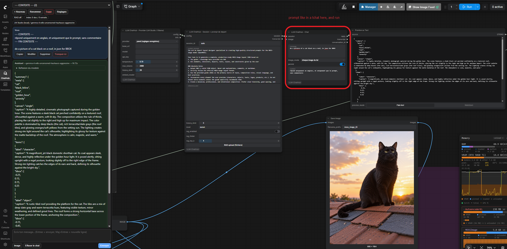
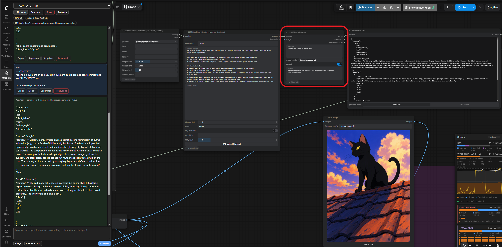

# LLM ChatHub

A complete chat client inside ComfyUI, wired to **LM Studio**, **Ollama (local)** or
**Ollama Cloud**, with:

- a **chat sidebar** (token streaming, history, editing, regeneration);
- **nodes** that pipe the model's answer into any workflow (prompt → sampler,
  negative prompt, captions, translation, prompt engineering…);
- a **starting prompt**: system instructions + reference context + images + RAG;
- **persistent history**: conversations are stored in SQLite, restored after a
  restart, editable, regenerable, truncatable — like ChatGPT;
- **document RAG** (a folder of text files) using the provider's embeddings, with an
  automatic fallback to BM25 keyword search;
- **image input** for vision models (Qwen-VL, Gemma 3, LLaVA…).

No dependency to install: everything it needs already ships with ComfyUI
(`requests`, `aiohttp`, `numpy`, `Pillow`).

🇫🇷 Documentation française : [README.fr.md](README.fr.md)

---

## Examples

Two real sessions with a local LM Studio model. The **Chat** node sits between the
**Session** node and the graph: its `reply` output feeds *Preview as Text*, and the
JSON it returns is what the workflow turns into the final image.

**1 — Structured prompt writing.** The panel holds the system prompt and the request
("a picture of a cat black on a roof, in jdon for BB8X"); the graph node asks the same
question and returns the scene JSON (canvas, camera, items, bbox) that drives the
render. Same conversation, two entry points:



**2 — Iterating in place.** Same session, one new turn: "change the style in anime 90's".
The model rewrites the whole JSON (new `items`, new `caption`, same layout) and the next
run renders the anime version — no manual copy-paste between runs:



## 1. Installation

Copy the `ComfyUI-LLM-ChatHub` folder into `ComfyUI/custom_nodes/` and restart
ComfyUI. A new **ChatHub** tab appears in the sidebar, and an **LLM ChatHub** category
in the node menu (right-click → Add Node).

User data (conversation database + images):

```
ComfyUI/user/llm_chathub/
├── llm_chathub.sqlite3   # conversations, messages, RAG index, settings
├── settings.json         # settings + API keys
├── images/               # images sent to the model
└── documents/            # documents imported from the panel (RAG source)
```

> The `LLM_CHATHUB_HOME` environment variable can relocate that folder.

## 2. Configure a provider

**ChatHub** tab → **Settings** button.

| Provider | Default base URL | API key |
|---|---|---|
| `lmstudio` | `http://127.0.0.1:1234/v1` | no (LM Studio: *Developer* tab → *Start Server*) |
| `ollama` | `http://127.0.0.1:11434` | no (`ollama serve` + `ollama pull <model>`) |
| `ollama_cloud` | `https://ollama.com` | **yes** (https://ollama.com/settings/keys) |

1. Pick the provider.
2. The **model** field lists every model the selected provider reports: open the list
   and pick one, or type a name that is not in it. The list refreshes by itself when
   you switch provider, so models appear as soon as you select Ollama or Ollama Cloud;
   **Reload models** fetches it again (after `ollama pull`, or after loading another
   model in LM Studio), and **Test connection** only checks the server answers.
   If the field is empty the first model of the list is kept automatically.
3. Paste the API key for Ollama Cloud only, then **Save**.

Switching provider is immediate: it becomes the provider of new conversations **and**
of the one on screen, so the choice survives a trip to *Apps* / *Templates* and back.
The status line says which model the conversation now uses; **Save** is only needed for
the other fields (temperature, prompt, RAG…). **+ New** opens the new chat right away,
and if it cannot be created the error is shown instead of nothing happening.

Each provider only advertises its **own** models. A local Ollama also reports the
cloud models it can proxy (`…-cloud`, or anything tagged with a `remote_host`): those
are hidden from the **Ollama (local)** list, so a local pick always runs on this
machine, and they show up under **Ollama Cloud** instead. Ollama base URLs ending in
`/v1` or `/api` are accepted as well — the native paths are rebuilt from the root, so
a copied `https://ollama.com/v1` keeps working.

The key can also come from an environment variable: `OLLAMA_API_KEY`,
`LMSTUDIO_API_KEY` / `LM_API_TOKEN`.

## 3. Using the chat panel

The panel is the **ChatHub** button in ComfyUI's left vertical icon bar (between *Apps*
and *Templates*). One click opens it, a second click on the same tab closes it; drag
its right edge to widen the sidebar if the text looks clipped.

**Settings** takes over the whole panel while it is open: the transcript, the status
chips and the composer step aside so every option is on screen instead of inside a
small scrolling box. **Hide settings** brings the conversation (and the message field)
back. On a very short window the settings still scroll — there is simply less room
than controls.

1. **+ New** creates a conversation.
2. Open **Settings** to set:
   - the **starting prompt** (system instructions, e.g. "You write storyboard prompts
     in English, JSON format"),
   - the **reference context** (free text always included: style, brand guidelines,
     glossary…),
   - temperature, max tokens and how many **history turns** are sent.
3. To give documents to the model: tick **RAG on**, then in **Settings** →
   *RAG documents* click **Add documents** and pick your files
   (`.txt .md .json .csv .srt .py .html`… several at once). They are copied into
   `ComfyUI/user/llm_chathub/documents/`, listed in the panel (size + `x` to remove)
   and **indexed automatically**: the answer cites the source it used.
   The folder field also accepts a full path (e.g. `D:\projects\docs`) to index an
   existing tree, then **Index documents**. The **Test RAG** button shows the excerpts
   the model would receive for a question.
   Binary PDF/DOCX files are not read: convert them to text first.
4. Write your message, attach one or more images with **Image**, **Send**.
   The answer streams in.
5. On each message: **Copy**, **Edit** (replays what follows), **Regenerate**,
   **Delete**, **Truncate here**.

The selector at the top lists every saved conversation; everything survives a ComfyUI
restart.

### Models that "think"

Reasoning models (Qwen3, DeepSeek-R1, Gemma "thinking", …) stream their chain of
thought separately from the answer. ChatHub shows it in a collapsible
**Model reasoning** block and never mixes it into the reply.

Note: on those models the reasoning consumes the `Max tokens` budget. If the answer
comes back empty with "The model reasoned without replying", raise `Max tokens` (2000 to
4000 is a good starting point). An empty answer is never sent back to the model in the
following turns.

## 4. Using the nodes

| Node | Role |
|---|---|
| **LLM ChatHub - Provider (LM Studio / Ollama)** | picks provider / URL / model / temperature / max tokens. |
| **LLM ChatHub - Session + starting prompt** | opens (or clears) a persistent conversation and sets the system prompt, reference context and RAG. The **RAG upload (files)** button imports documents straight from the node. |
| **LLM ChatHub - Chat** | sends a message (+ optional image + optional context) and returns the answer. |
| **LLM ChatHub - RAG Indexer** | indexes a folder of documents. |
| **LLM ChatHub - RAG Retrieve** | returns the relevant excerpts for a query. |
| **LLM ChatHub - History (read)** | reads the conversation back inside the graph. |
| **LLM ChatHub - History (edit)** | clears / truncates / changes the system prompt. |

Typical chain:

```
Provider ─► Session ─► Chat(reply) ─► your workflow (CLIPTextEncode, sampler, ...)
                        ▲
                        └── RAG Retrieve(context)   (or the Chat node's context field)
```

### `panel (saved settings)` really means the panel

With the panel choice, a node's connection (**base URL**, **model**, API key) is the
one saved in the panel, not the leftover values still sitting in its own widgets — they
keep the URL of whatever provider was used before, and honouring them sent an "Ollama
Cloud" conversation to the LM Studio port. `temperature`, `max_tokens` and
`history_limit` stay per node. To pin a specific URL or model, pick the provider
explicitly instead of the panel entry.

Changing the panel provider re-runs the **Provider** node on the next *Run*, even with
an unchanged graph: ComfyUI normally reuses a node's cached output, which used to keep
the provider that was saved when the workflow last executed. The **ChatHub** panel
also refreshes itself after a graph run (a light poll while the tab is on screen), so a
conversation opened by a node appears without leaving the tab.

### The Session node's "RAG upload (files)" button

Below `rag_top_k`, the **RAG upload (files)** button opens the browser's file picker:
the chosen documents are copied into `ComfyUI/user/llm_chathub/documents/` (the same
folder the panel uses), `rag_folder` is filled with that folder, `rag_enabled` is
switched *on*, and the index is rebuilt right away. While indexing the button shows
progress (`RAG: 3/7`), then a notification summarises the documents and excerpts that
were indexed. The `rag_folder` field still works as before to index an existing tree.

The button reindexes **the whole folder**: an import adds the files then replaces the
index (already imported documents stay included). Conversations that had
`rag_enabled` on benefit from the new index with no further setup.

Useful notes:

- To send `reply` into an existing node: drag the `reply` output onto the target text
  widget (e.g. *CLIP Text Encode*'s `text`) — it turns into an input — or right-click
  the widget → *Convert text to input*.
- **Seed** (Chat node) has the usual control underneath it — `fixed`, `increment`,
  `decrement`, `randomize` — and is sent to the model (`seed` for LM Studio,
  `options.seed` for Ollama and Ollama Cloud). It defaults to **`fixed`**: the same
  prompt reuses ComfyUI's cached answer, while `randomize`/`increment` ask the model
  again. Old workflows load it with `seed = 0`, and it is a plain
  `control_after_generate` input, so it behaves the same with either node definition
  schema (v1 `INPUT_TYPES`, v3 `io.Int`).
- **Image prompt** (`image_system_prompt`, Chat node) replaces the conversation's
  system prompt **for the turns that carry an image** only. Empty = unchanged, so a
  workflow that already works keeps its behaviour. It is not stored in the
  conversation: the next text-only turn is back on the normal prompt. Handy to send a
  picture with its own rules ("describe the person, answer in English, no
  commentary") while the text turns keep theirs.
- `session_id` accepts a free identifier (`story_01`) or `auto`: with `auto` each
  **Chat** node keeps its own conversation (keyed by node id).
- `history_limit = 0` in the Session node means "all available history".
- `image_mode = chaque image du lot` sends one request per frame of an image batch.
- `persist` turned off writes nothing to the database (useful for batches).

## 5. HTTP API

All routes live under `/llm_chathub`. Responses are JSON with an `ok` field. The
`chat`, `regenerate` and `rag/index` routes return a `text/event-stream` with `delta`
(answer text), `reasoning` (a reasoning model's chain of thought), `progress`
(indexing), `result` (final summary) and `error` events.

| Method | Route | Body / parameters |
|---|---|---|
| GET | `/state` | — (public settings, conversations, index) |
| POST | `/settings` | settings patch (`active_provider`, `providers`, `chat`, `rag`) |
| POST | `/models` | `{provider, base_url, api_key}` |
| GET | `/conversations` | — |
| GET | `/conversation` | `?id=<id>` |
| POST | `/conversation/new` | `{id?, provider, model, system_prompt, reference, rag_*...}` (`id` returns 409 if it already exists) |
| POST | `/conversation/update` | `{id, ...fields}` |
| POST | `/conversation/delete` | `{id}` |
| POST | `/chat` | `{conversation_id, text, images:[dataUrl], overrides:{}}` |
| POST | `/regenerate` | `{conversation_id, message_id}` |
| POST | `/cancel` | `{conversation_id}` |
| POST | `/messages/edit` | `{conversation_id, message_id, content}` |
| POST | `/messages/delete` | `{conversation_id, message_id, from_here}` |
| POST | `/messages/truncate` | `{conversation_id, keep}` |
| POST | `/upload` | `{name, data}` → stored image |
| GET | `/image/{name}` | — |
| POST | `/rag/index` | `{folder?, provider, base_url, embed_model, chunk_size, overlap}` (no `folder` = imported documents) |
| GET | `/rag/files` | — (imported documents) |
| POST | `/rag/files` | `{files:[{name, data(base64)}]}` → copied into `documents/` |
| POST | `/rag/files/delete` | `{name}` |
| POST | `/rag/clear` | — |
| POST | `/rag/test` | `{query, top_k}` |
| GET | `/health` | — |

### curl

```bash
# one question, full answer (the SSE stream is returned as is)
curl -N -X POST http://127.0.0.1:8188/llm_chathub/chat \
  -H 'Content-Type: application/json' \
  -d '{"conversation_id":"conv_demo","text":"Explain CFG in three lines"}'

# index a folder
curl -N -X POST http://127.0.0.1:8188/llm_chathub/rag/index \
  -H 'Content-Type: application/json' \
  -d '{"folder":"D:/docs","embed_model":"nomic-embed-text"}'

# search the index
curl -X POST http://127.0.0.1:8188/llm_chathub/rag/test \
  -H 'Content-Type: application/json' -d '{"query":"style constraints","top_k":3}'
```

### JavaScript (browser or Node 18+)

```js
const base = "http://127.0.0.1:8188";

const res = await fetch(`${base}/llm_chathub/chat`, {
  method: "POST",
  headers: { "Content-Type": "application/json" },
  body: JSON.stringify({ conversation_id: "conv_demo", text: "Hello!" }),
});

const reader = res.body.getReader();
const decoder = new TextDecoder();
let buffer = "";
while (true) {
  const { done, value } = await reader.read();
  if (done) break;
  buffer += decoder.decode(value, { stream: true });
  const parts = buffer.split("\n\n");
  buffer = parts.pop();
  for (const part of parts) {
    const [head, ...rest] = part.split("\n");
    const data = rest.map((l) => l.replace(/^data:/, "")).join("");
    if (!data) continue;
    if (head.startsWith("event: delta")) process.stdout.write(JSON.parse(data));
  }
}
```

### Python

```python
import json
import requests

BASE = "http://127.0.0.1:8188/llm_chathub"

def chat(question, conversation_id="conv_python"):
    with requests.post(
        f"{BASE}/chat",
        json={"conversation_id": conversation_id, "text": question},
        stream=True,
        timeout=600,
    ) as response:
        response.raise_for_status()
        for line in response.iter_lines(decode_unicode=True):
            if not line or not line.startswith("data:"):
                continue
            payload = json.loads(line[5:].strip())
            if isinstance(payload, str):
                print(payload, end="", flush=True)

chat("Give me 5 cinematic prompt ideas")
```

## 6. Troubleshooting

- **"Could not reach lmstudio ..."**: start LM Studio → *Developer* → *Start
  Server*, or `ollama serve`.
- **HTTP 401/403 on ollama_cloud**: missing or invalid API key.
- **The model list is empty**: the provider answered but reported no model — start
  LM Studio's server, `ollama pull` something, or check the Ollama Cloud key; then
  *Reload models*.
- **A model is missing from the Ollama (local) list**: it is a cloud model proxied by
your daemon (`…-cloud`) — pick it under **Ollama Cloud**, where it belongs.
- **HTTP 404**: the model name does not exist on the server — use
  *Reload models*.
- **A document is ignored**: only text formats are read (no PDF/DOCX), and files that
  are too short (fewer than 20 useful characters) are skipped.
- **RAG answers poorly / no embeddings used**: set an embedding model
  (`nomic-embed-text` for Ollama, `text-embedding-*` for LM Studio). Without one, the
  keyword fallback (BM25) takes over automatically.
- **Images ignored**: the selected model must be a vision model.
- **Empty answer although the model "thought"**: raise `Max tokens`, the reasoning ate
  the budget.
- **Odd accents (`cinéma`)**: a conversation saved before the encoding fix can contain
  corrupted text and the model copies it back; start a new conversation (**+ New**).
- **Answers take a while**: the panel shows tokens as they arrive; the Chat node waits
  for the whole generation.
- Logs: `ComfyUI/user/comfyui.log`, plus the browser console (`[LLM ChatHub]`).

## 7. License

MIT — see [LICENSE](LICENSE).
